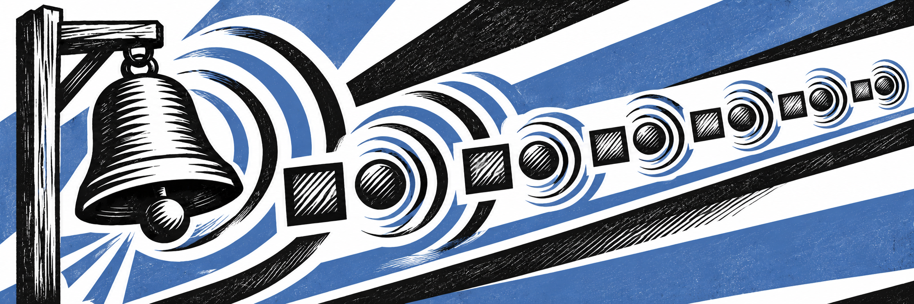
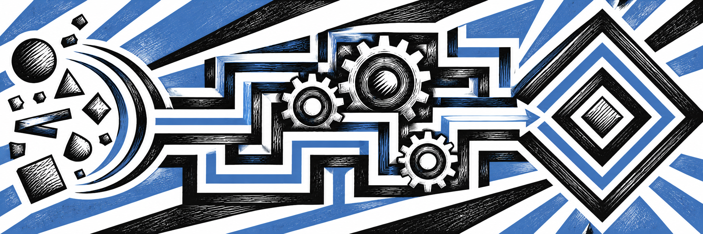
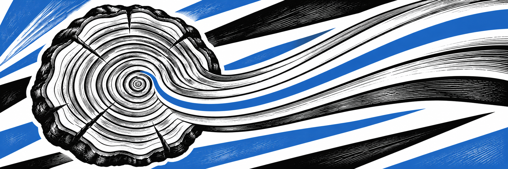



    <input type="radio" name="course-tabs" id="tab-overview" checked>
    <label for="tab-overview">Overview</label>
    <input type="radio" name="course-tabs" id="tab-assignments">
    <label for="tab-assignments">Assignments</label>
        

# Unit 1: Copyright


{{ included_content | markdownify }}

# Unit 2: Behaviorism 


{{ included_content | markdownify }}

# Unit 3: Cognativism


{{ included_content | markdownify }}

# Unit 4: Constructivim


{{ included_content | markdownify }}

# Unit 5: Connectivism 


{{ included_content | markdownify }}

# Unit 6 Andragogy


{{ included_content | markdownify }}

# Unit 7

# Unit 8

 

    

# Unit 2: Applying Behaviorism and Gagné’s Nine Events Lesson Plan Outline

**Student Name:** Leigh Lawhon  
**Course:** LDTC 600  
**Date:** 10/27/2026

## 1. Subject Selection

**Chosen Subject:** Applying Team Formatting and Commenting Standards Through Developer Code Review

This lesson introduces beginning software developers to reviewing and revising code using a shared style guide. Learners practice identifying formatting issues, writing useful comments, and giving specific, professional feedback. The focus is on observable review behaviors and applying team conventions consistently.

## 2. Scenario Development

**Learning Scenario:**

I want to help beginning developers participate confidently in code review. When I was a designer transitioning into coding, a colleague left an inline comment containing farm animals to suggest that I had left too many blank lines in my code. The joke drew attention to the issue, but it did not clearly explain the expected standard. In this lesson, I would make those expectations explicit and teach learners how to give feedback that helps someone revise their work.

Learners will work with a short JavaScript function, a team style guide, and a review checklist. The guide will specify spacing conventions and explain when comments should clarify purpose or nonobvious reasoning. Learners will review a practice submission, exchange feedback, and revise their code before completing an independent assessment.

I will use specific recognition to encourage the desired behaviors. For instance, I might say, “You identified the extra blank lines, connected your feedback to the style guide, and explained the revision clearly.” This recognition would function as positive reinforcement if those behaviors increased in later reviews. I will also recognize helpful collaboration, while checking each learner’s performance independently.

During practice, learners can “Ask a Reviewer”—a classmate or me—when they need help interpreting a guideline. I will record the support needed to plan further instruction. Practice assistance will not count as evidence of independent mastery. Incorrect responses will receive clear corrective feedback and an opportunity to revise. Sarcasm and public embarrassment will have no role in the review process.

## 3. Lesson Plan Outline

**Instructional Framework:** Gagné’s Nine Events of Instruction  
**Audience:** Beginning developers who can read and write a basic JavaScript function  
**Estimated Duration:** 60 minutes  
**Materials:** Team style guide, review checklist, practice code, independent assessment code, and a shared editor or review tool

### 1. Gain Attention — 5 minutes

Display two versions of the same working function: one with inconsistent spacing and unclear comments, and one that follows the team’s conventions. Ask learners to identify which version would be easier to review and maintain, and explain why.

**Script:** “Both versions produce the same result. What makes one easier for another developer to understand? Today, we will practice making code easier to review and giving feedback that helps the author improve it.”

### 2. Inform Learners of Objectives — 3 minutes

Explain that, by the end of the lesson, learners will independently:

- Identify at least four of five deliberately included formatting or commenting issues in a short code submission.
- Revise the submission to meet all five corresponding style-guide criteria without changing its behavior.
- Write two professional review comments, each identifying a specific issue, connecting it to a shared criterion, and suggesting an actionable revision.

**Script:** “You can ask for help during practice. At the end, you will review a new submission independently using the same style guide and checklist. You will demonstrate both how to improve the code and how to explain the change respectfully.”

### 3. Stimulate Recall of Prior Learning — 5 minutes

Ask learners to recall a time when they read someone else’s code or returned to their own code after a break.

**Prompts:** “What helped you understand the function? Which comments added useful information? What made feedback easy or difficult to act on?”

Briefly review the distinction between code that runs correctly and code that follows agreed team conventions. Invite learners to connect their observations to the displayed submissions.

### 4. Present the Content — 10 minutes

Introduce the team style guide and explain the purpose of each review criterion. Model a review of a short function by identifying excessive blank lines, inconsistent indentation, an inaccurate comment, and a comment that merely repeats an obvious statement.

Think aloud while revising the submission. Show how a comment can explain a function’s purpose or a nonobvious decision. Run the supplied checks before and after the revision to confirm that the changes preserve behavior.

Model this review comment: “Remove the extra blank lines between these statements to follow the team’s spacing convention.” Explain how it identifies a location, names the criterion, and requests a concrete change.

### 5. Provide Learning Guidance — 5 minutes

Introduce a review checklist:

1. Read the function to understand its intended behavior.
2. Compare spacing and indentation with the team style guide.
3. Check whether comments are accurate and explain useful information.
4. Write feedback that names the issue and suggests a revision.
5. Revise the code and check that it still behaves as intended.

Provide a feedback sentence frame: “In [location], [specific issue] differs from [criterion]. Please [actionable revision].” Explain that learners can adapt the wording as long as the feedback remains clear and professional.

### 6. Elicit Performance Through Practice — 12 minutes

Give pairs a practice function containing five planned formatting and commenting issues. Each learner first identifies issues individually. Partners then compare findings, write review comments, and revise the code.

Learners may use “Ask a Reviewer” when they need help. I will prompt them to locate the relevant guideline and explain their reasoning before offering a direct answer. Partners will switch author and reviewer roles so each person practices giving and applying feedback.

### 7. Provide Feedback — 5 minutes

Provide immediate, specific feedback during practice and use this time to discuss common findings.

**Recognition:** “Your comment names the spacing issue and points to the shared rule. That gives the author a clear next step.”

**Correction:** “You noticed that the comment needs work. Explain what is inaccurate and suggest wording that matches the function’s behavior.”

Ask authors to paraphrase the requested change. If the request is unclear, help the reviewer revise it. Track whether learners apply this feedback in subsequent comments rather than assuming that praise or correction has produced learning.

### 8. Assess Performance — 10 minutes

Provide a new function containing five deliberately included issues aligned with the same style guide. Learners complete the review independently with access to the guide and checklist, but without peer or instructor coaching.

Assess three components:

- **Identification:** Correctly identifies at least four of the five planned issues.
- **Revision:** Meets all five targeted style-guide criteria and preserves the function’s behavior, verified with the supplied checks.
- **Feedback:** Writes two comments, each stating a specific issue, connecting it to a criterion, and proposing an actionable revision in professional language.

Learners must meet each component rather than compensate for one weakness with a higher score elsewhere. Those who need further practice receive targeted feedback and another opportunity using a different submission. Record assisted practice separately from independent assessment.

### 9. Enhance Retention and Transfer — 5 minutes

Ask learners to identify one review habit they will use in their next project. Discuss how they would respond if another team used different conventions: they should consult that team’s guide and distinguish shared requirements from personal preferences.

In the next class or project review, have learners apply the process to unfamiliar code and explain one revision. Compare their performance with the initial assessment to check retention and transfer. Continue access to the style guide while reducing instructor reminders as learners become more independent.

## 4. Reflection

**Reflection on Behaviorism and Gagné’s Nine Events:**

My experience receiving a sarcastic code review comment helps me see why clear expectations matter. I learned that my spacing differed from my colleagues’ preferences, but the feedback did not provide a useful rule I could apply independently. As an instructor, I would establish shared criteria before asking learners to submit work and model the kind of feedback I want them to give.

Behaviorism helps me focus on observable actions: identifying issues, applying conventions, and writing actionable review comments. Specific recognition may encourage these behaviors, but I need to examine later submissions to determine whether it functions as reinforcement. Corrective feedback also needs to identify what learners should change and give them an opportunity to practice the revision.

Code review can involve learned emotional associations as well as consequences for performance. Repeatedly humiliating feedback could make review cues uncomfortable for a learner. That possibility strengthens my commitment to respectful, predictable review conditions. I would monitor willingness to ask questions and submit work alongside improvements in formatting.

Gagné’s nine events give the lesson a sequence from attention and recall through guided practice, independent assessment, and transfer. The paired practice allows learners to exchange explanations, while the individual assessment shows what each person can do without coaching. Using a style guide during assessment reflects how developers work and measures application rather than memorization.

A limitation of this lesson is that following conventions does not establish broader programming competence. I would ask learners to explain their choices and apply the review process to unfamiliar code to gather evidence of understanding. I would also check that revisions preserve behavior rather than reward appearance alone.

I used AI to help adapt my original algebra lesson into a developer code review lesson and align the activities with the discussion of behaviorism. The personal code review experience came from my own reflection. I remain responsible for reviewing the draft, checking it against course materials, and following the course’s AI-use requirements.

## 5. References

Skinner, B. F. (1953). *Science and human behavior*. Macmillan. https://www.bfskinner.org/wp-content/uploads/2014/02/ScienceHumanBehavior.pdf

*Reference completion note: Add the assigned course source for Gagné’s nine events and any required AI citation before submission. Its bibliographic information was not included in the original outline.*

# Unit 3: Cognativism Understanding How I Learn

I taught myself to code, enjoyed solving puzzles, and was placed in advanced mathematics classes in school. I loved Statistics. It made sense. I can reverse engineer, breakdown and reorganize essays, and understand the big picture of complex systems as a whole.

However, I struggled with word problems, often missed details in mathematical work, and have to force myself into details. Later in life, difficulties appeared in job interviews such as coding challenges and annalist assessments. Understanding how to code or calculate the optimal discount for a sale did not mean I could reliably solve a basic problem presented through verbal instructions. I would practice these for hours before an interview, trying different methods and they never worked. My brain just didn't work that way and I gave up. I felt dumb.

Cognitivism provides a framework for examining this gap because it focuses on the processes involved in attending to, interpreting, organizing, storing, and retrieving information. My experiences with dyslexia and ADHD provide personal context, but neither label fully explains how I overcame these challenges and succeeded as a life-long learner. 

My personal experiences provide a lens for evaluating cognitivism and I argue that cognitivism offers valuable principles for instructional design, particularly when designers investigate learners’ strategies and prior knowledge while preparing them to apply knowledge independently.

But, how does one instructor do that for a whole classroom and how do they prepare without an understanding of each learner's unique perspective.

### From Observable Performance to Cognitive Processes

Cognitivism developed partly in response to the limitations of explaining learning primarily through observable behavior. Michela (2018) identifies research on expectations, insight, and purposeful activity by researchers such as Edward Tolman and Wolfgang Köhler during the 1920s and 1930s as important precursors. Cognitive approaches gained prominence during the 1950s, directing greater attention toward what happens between receiving information and producing a response, the "Black Box."

Cognitivism encompasses multiple theories rather than one universally accepted explanation, which I like. It's complex and evolves as one gets older. Information-processing approaches examine attention, working memory, encoding, and long-term memory. Cognitive load theory examines the demands that learning places on limited processing resources. Self-regulated learning, one of my favorite topics, emphasizes learners’ roles in planning, monitoring, and adjusting their learning (Michela, 2018). Are instructional designers capable of addressing this complex matrix for every learner?

For teaching, these approaches shift attention toward how learners interpret a task and select strategies. An incorrect answer might reflect a calculation error, a misunderstood relationship, an ineffective strategy, or difficulty coordinating information. The answer alone cannot establish which explanation applies. I myself how and why a mathematical word problem flummoxed me every time.

This distinction matters to me because I was described as smart but as someone who did not apply herself. I remember being curious, experimenting, and trying new things. I could sit still and work on homework, yet miss details and need to reread. Cognitivism encourages a more informative question than whether I tried hard enough: what processes did the task require, and where did my approach stop working?

### Attention, Encoding, and Prior Knowledge

My attention varies considerably across activities. I can paint or write for hours, while I continuously interrupt myself with distractions trying to settle into monthly bills and piled up mail. Michela (2018) explains that attention is influenced by factors including familiarity, motivation, and individual differences. This helps me consider the interaction between the learner and the task without assuming that sustained attention in one setting should automatically occur elsewhere.

Encoding is particularly meaningful to me. I think of it as "known, unknown, and unknown-unknown" and I build paths connecting dots, even when they are disparate. Michela (2018) describes organization, elaboration, and schemas as processes that connect new information with existing knowledge. Elaboration involves expanding information or connecting it to something already understood. Schemas provide structures through which situations and relationships can be interpreted.

My experience teaching myself to code helps me form a mental model of these connections. I began with conditional (IF ELSE) functions in Excel and, as an Adobe software instructor, became curious about how software was organized in order to teach it. Building websites and portfolios later gave me reasons to learn HTML, JavaScript, ActionScript, and CSS. A curriculum of necessity that started a career.

When a website required Django/Python, I used two books. An older book provided a tutorial for a content management system similar to what I needed. A newer book explained related concepts using the current language version. I followed the older project while reconstructing its implementation through the newer material. I had to create a workable sequence by comparing what remained consistent with what had changed.

This was purposeful, active learning. New information revised the organization of what I knew. I recognize a similar process in painting multiple versions of one subject. Comparing compositions and experimenting with color and brush work helps clarify my decisions. Sometimes the painting I initially like least becomes the most successful because it provides room to experiment. Sometimes they just get shoved in a corner.

### Guidance, Interaction, and Multiple Perspectives

Jerome Bruner’s work provides a way to examine instructional support. Wood et al. (1976) described scaffolding through a study of tutoring young children in a construction task. Their account emphasizes assistance that allows learners to address parts of a task they could not initially manage alone. Although this was not a study of dyslexia or ADHD, it offers a useful question for my context: which aspects of a professional learning task require support and which supports work for an individual? How can I teach myself math word problems when supports haven't worked?

My books provided structures I could adapt, but videos demonstrating interview solutions did not produce the same outcome. The explanations made sense while I watched. When I attempted exercises independently, I struggled for hours. This suggests that a complete demonstration may need additional support that helps a learner identify why a particular step is appropriate and when to use it.

Lev Vygotsky contributes a related sociocultural perspective. His zone of proximal development concerns the distance between what learners can accomplish independently and what they can accomplish with guidance (Vygotsky, 1978). The publication date of *Mind in Society* reflects a posthumous collection of his earlier work.

For me, the ZPD raises questions about the fit of assistance. Coaching did not always resolve my difficulty constructing a solution. That experience does not disprove the theory, but it makes me question whether the assistance addressed the point where my understanding broke down. Social interaction also needs attention to its quality; participation alone does not establish that an interaction supports learning.

Rand Spiro and colleagues offer another connection through cognitive flexibility theory. Their work addresses advanced knowledge acquisition in complex, ill-structured domains, emphasizing multiple representations and contexts (Spiro et al., 1988). My two-book experience provides a personal analogy: comparing implementations helped me reconstruct concepts. However, applying this theory to my experience is an interpretation, not evidence that the approach has been validated for my learning differences.

### What Word-Problem Research Contributes

Research by Fuchs et al. (2018) helps clarify why calculation ability and word-problem performance should be examined separately. They followed 325 second-grade students, assessing cognitive, language, reading, and mathematical skills near the beginning and end of the school year. Initial language ability predicted later word-problem outcomes more strongly than calculations, while initial arithmetic skill predicted calculations more strongly than word-problem outcomes.

Text comprehension predicted all outcomes, and contrary to the researchers’ expectations, its predictive strength was comparable across calculations and word-problem outcomes. These findings support a nuanced relationship rather than a complete separation between mathematical and language processes, and is reinforced by my highschool SAT scores.

The authors explain word-problem solving through the construction of representations, inferences, and relationships among quantities. Their instructional discussion emphasizes language and problem representation alongside computation. This connects to my experience of understanding the requested outcome without being able to construct the solution.

The study involved children and did not test an instructional intervention. It cannot explain my adult interview experiences or establish their cause. Nevertheless, it supports asking whether instruction addresses interpreting relationships and organizing a solution rather than concentrating mainly on calculation practice.

### Implications for Instructional Design

In adult professional learning, I would begin by identifying the decisions a task requires and gathering evidence about where learners struggle. For a word problem, an assessment might separately ask learners to explain the goal, represent relationships, propose an initial step, and justify that choice. Those responses could be more informative than a single final answer.

This approach also offers a manageable starting point for a large class, an implementation I have struggled with. An instructor could collect brief responses, identify recurring difficulties, and provide temporary groups or targeted prompts. The instructor would still need to monitor individual progress, but would not have to create bespoke material for each student.

Self-regulated learning provides another useful principle. My self-directed projects involved goals, resources, experimentation, and strategy changes. In teaching, I would make those processes visible rather than assume learners already know how to manage them. Learners could set a goal, choose a strategy, evaluate its effect, and decide what to change. Michela (2018) emphasizes planning, self-monitoring, and feedback as relevant design considerations.

Bandura’s (2001) social cognitive theory further connects agency with personal and environmental influences. Personal  responsibility must be considered alongside available opportunities and support. Motivation and confidence matter, but they do not guarantee successful performance. Having a deadline and a paycheck that depends on success seems to have shaped my sense of responsibility and grit.

My recent use of conversational AI has helped me connect cognitivism to personal experiences through questions and reflection. This may offer an instructional possibility, but I have not established that it improves my independent word-problem solving. That would require practice and assessment without the conversational assistance.

### Evaluating an Online Instructional Material

The instructional material I selected is OpenStax’s [“Use a Problem-Solving Strategy”](https://openstax.org/books/elementary-algebra-2e/pages/3-1-use-a-problem-solving-strategy), from *Elementary Algebra 2e*. The lesson introduces a seven-step strategy for algebra word problems. It includes prerequisite checks, worked solutions, and practice opportunities (Marecek et al., 2020). 

First off, the opening emphasis on positive thinking likely would not help, as my bad experiences are deeply engrained. I personally needed help identifying and practicing the missing reasoning.

The first cognitive load principle is **demonstrating problem solving to reduce unnecessary search demands**. Michela (2018) identifies demonstrations as one strategy for managing cognitive load. OpenStax’s first example shows how to translate a purchase scenario into an equation, solve it, and check the answer. My proposed improvement would add prompts asking learners to explain the mathematical relationship based on the question.

For example, before asking students to provide the answer, I would ask, “Which amount is half of the other? Why?” A student might explain that the $18 sale price represents half of the unknown original price, leading to the equation \(18 = \frac{1}{2}p\). Perhaps this prompt would help the instructor distinguish difficulty interpreting the relationship from difficulty performing the calculation.

The second principle is **organizing information into manageable components**. The lesson’s numbered stages and solution tables provide structure. For learners like me, I would supplement these with partially completed problems and feedback at the representation stage, before requiring a full solution. 

Example 3.5 is where the lesson becomes especially abstract for me. There is no real world mental model for me. The instruction to express two numbers using one variable assumes that I can translate their relationship into symbols. I would add a simple visual showing two equal unknown lengths, with five extra tick marks attached to the second. This would make “five more” visible: removing those five extras from the combined total of 21 leaves 16 shared equally between the two matching lengths. Each length therefore represents 8, making the numbers 8 and 13. Placing the visual beside the equation could help connect the wording to the mathematical relationship, reducing the need to hold that relationship entirely in working memory.

Something like this:

### Strengths, Limitations, and Future Questions

Cognitivism’s greatest strength in my context is its attention to processes that an answer cannot fully reveal. It encourages designers to investigate prior knowledge, interpretation, memory demands, and strategy use. Its limitation is that these processes are difficult to infer, and responsive assessment requires time. A broad framework does not automatically identify the right assistance.

I also question personalization that keeps instruction within familiar interests. Analogies such as explaining economics through a grocery store may provide an entry point, but education, particularly in the AI era, should introduce relationships and perspectives beyond that analogy. I would personalize support while deliberately expanding learners world views once they can accomplish the learning objective.

This connects to my emerging idea of perspective learning: comparing representations and experiences to identify similarities, conflicts, and new possibilities. I believe it is the only way to elevate education toward the unknown-unknown and a more multi-faceted understanding of the world. For now, it remains an idea to investigate. Cognitivism gives me a foundation for asking how those comparisons support understanding—and how instruction can help that understanding become independent performance.

### References

Bandura, A. (2001). Social cognitive theory: An agentic perspective. *Annual Review of Psychology, 52*, 1–26. https://doi.org/10.1146/annurev.psych.52.1.1

Fuchs, L. S., Gilbert, J. K., Fuchs, D., Seethaler, P. M., & Martin, B. N. (2018). Text comprehension and oral language as predictors of word-problem solving: Insights into word-problem solving as a form of text comprehension. *Scientific Studies of Reading, 22*(2), 152–166. https://doi.org/10.1080/10888438.2017.1398259

Marecek, L., Anthony-Smith, M., & Mathis, A. H. (2020). *Elementary algebra 2e*. OpenStax. https://openstax.org/details/books/elementary-algebra-2e

Michela, E. (2018). Cognitivism. In R. Kimmons (Ed.), *The students’ guide to learning design and research*. EdTech Books. https://edtechbooks.org/studentguide/cognitivism

Spiro, R. J., Coulson, R. L., Feltovich, P. J., & Anderson, D. K. (1988). *Cognitive flexibility theory: Advanced knowledge acquisition in ill-structured domains* (Technical Report No. 441). University of Illinois at Urbana-Champaign, Center for the Study of Reading. https://files.eric.ed.gov/fulltext/ED302821.pdf

Vygotsky, L. S. (1978). *Mind in society: The development of higher psychological processes* (M. Cole, V. John-Steiner, S. Scribner, & E. Souberman, Eds.). Harvard University Press.

Wood, D., Bruner, J. S., & Ross, G. (1976). The role of tutoring in problem solving. *Journal of Child Psychology and Psychiatry, 17*(2), 89–100. https://doi.org/10.1111/j.1469-7610.1976.tb00381.x

# Unit 4: Scenario
At the Harbor Community College, 24 adult learners enroll in a six-week Enhancing Public Space Workshop. The workshop is a pilot program for a proposed interdisciplinary degree pathway in which students build a coherent education through a unique self-directed degree, which allows learners to build competencies across topics and decide on their own completion. 

The workshop challenges learners to make a modification to  the local neighborhood library and make it a more accessible community learning space within a limited budget. Students investigate the library using an instructor-prepared floor plan, anonymized visitor data, accessibility observations, interview transcripts, and cost estimates. They must develop, test, and defend an improvement proposal. The scenario combines spatial design, statistics, communication, technology, and civic decision-making around one consequential problem.

The students all come from different experiences. Maya can sketch spaces and recognize visual patterns but cannot independently interpret visitor data. Luis can calculate costs but struggles to incorporate qualitative evidence. Amina can analyze interview themes but needs support designing a fair prototype test. Each student has their own unique entry point into their unique learning experience. 

An entry point could include: existing knowledge, interests, language, practical experience, and confidence in a particular context. The instructor kicks off the workshop by having student interview each other and fill out an assessment to help define potential entry points, overlaps and opposition. The instructor uses this information to build a scenario, using AI, that compliments the teams and connect new demands to existing understanding while checking for misconceptions. (National Academies of Sciences, Engineering, and Medicine [NASEM], 2018).

Constructivism guides the workshop because students develop explanations through investigation and revision. Piaget's (1936/1952) distinction between assimilation and accommodation helps explain the intended change: students may incorporate evidence into an existing schema or revise that schema when it cannot adequately explain what they encounter. 

For example, a team initially assumes that additional digital kiosks will improve access. A prototype test reveals that the placement obstructs movement and that some visitors prefer human assistance. This discrepancy creates an opportunity to reconsider the team's definition of accessibility. Cognitive equilibrium represents a more coherent, revisable explanation. The instructor supports the reasoning process through questions, demonstrations, and feedback; constructing understanding does not require unguided discovery.

The workshop adapts the BSCS 5E sequence: Engage, Explore, Explain, Elaborate, and Evaluate (BSCS Science Learning, n.d.). During Engage, students compare competing visitor accounts and record predictions about the library's problems. During Explore, teams examine the supplied evidence, build inexpensive models, and conduct structured role-based walkthroughs. During Explain, they present their initial interpretations before receiving targeted instruction on sampling, accessibility criteria, and evidence-based claims. During Elaborate, they revise a prototype and test it under a new constraint, such as reduced funding or increased attendance. During Evaluate, they defend their conclusions, assess the limits of their evidence, and complete an independent transfer task. Reflection occurs throughout the cycle.

Each team tests two versions of one intervention, such as signage, seating arrangements, or a service-information interface. Students predict an outcome, identify what they will measure, keep relevant conditions consistent, and document unexpected results. Classmates test navigation tasks while following assigned constraints, and teams compare completion patterns and feedback. The instructor evaluates the quality of the investigation and revision rather than whether a team's first design succeeds. An unsuccessful prototype can generate valuable evidence when learners explain what it reveals.

Vygotsky's (1978) Zone of Proximal Development distinguishes independent performance from performance possible with capable assistance. The instructor identifies each learner's ZPD through a brief attempt, a graduated prompt, and another attempt. A task belongs within the learner's working ZPD when assistance enables meaningful progress that independent performance does not yet support. If even substantial guidance produces little understanding, the instructor first addresses prerequisite knowledge. The three skills below are initial hypotheses that must be confirmed individually.

## ZPD Skills

### Interpret quantitative evidence alongside community perspectives

**Independent Start:** Learners can read a simple table or summarize an interview but cannot yet independently reconcile conflicting numerical and qualitative findings.

**Guided Performance:** With a partially completed comparison chart and instructor prompts, learners connect visitor counts with interview themes, question whose perspectives are missing, and qualify an interpretation.

**Independent Target:** Each learner analyzes evidence, makes a supported claim, and identifies one limitation without the chart or interpretive prompts.

### Design and interpret a fair prototype comparison

**Independent Start:** Learners can suggest improvements but cannot yet separate an appealing idea from a testable claim or control major differences between trials.

**Guided Performance:** Using a modeled example and peer questioning, learners define a measurable outcome, maintain comparable testing conditions, and explain alternative reasons for a result.

**Independent Target:** Each learner designs a small comparison for an unfamiliar service problem, interprets supplied results, and proposes a justified revision.

### Integrate disciplinary perspectives into a defensible recommendation
**Independent Start:**  Learners can explain an issue through a familiar perspective but cannot yet independently balance spatial, financial, and community considerations.

**Guided Performance:** A decision matrix and facilitated dialogue help learners compare competing criteria, explain trade-offs, and revise a proposal when another discipline exposes a weakness.
    
**Independent Target:** Each learner defends a recommendation using at least two disciplinary perspectives and explains how an additional constraint would change the decision.

## Scaffolding and Social Constructivism

## Contingent Support
The primary scaffolding strategy is a model-practice-fade sequence. Wood et al. (1976) describe tutoring functions that include simplifying a task, maintaining direction, highlighting important features, and managing frustration. In this workshop, the instructor first thinks aloud through an unrelated example, demonstrating how to distinguish a claim from evidence and uncertainty. Students then use a partially completed evidence chart and test-planning checklist. During conferences, the instructor begins with an open question, adds a cue if needed, and models one step only when lesser assistance is insufficient. Support responds to observed difficulty rather than a predetermined label. Templates gradually lose prompts, and learners ultimately tackle an individual problem without interpretive assistance.

## Collaborative Knowledge Construction
The social constructivist approach is a reciprocal expertise exchange. Teams initially divide evidence among temporary investigation groups focused on spatial access, resource allocation, or visitor communication. Students return to their project teams and teach the reasoning behind their findings. Peers must paraphrase the explanation, identify an uncertainty, and ask a question that could change the recommendation. Teams then produce a shared decision record documenting disagreements, supporting evidence, and revisions. This makes collaboration an opportunity to negotiate meaning rather than simply divide production tasks. Consistent with Vygotsky's (1978) emphasis on socially mediated learning, dialogue supports reasoning that individuals subsequently practice independently. Rotating roles prevents initial strengths from becoming permanent disciplinary boundaries.

## Differentiation and Diversity

Differentiation begins with the diagnostic evidence and continuing learner feedback. A student unfamiliar with spreadsheets receives a short prerequisite activity; a student already proficient in basic analysis investigates sampling bias or uncertainty. Evidence packets include accessible text, labeled visuals, and captioned demonstrations, with equivalent access to the same substantive information. Multilingual learners may annotate in a preferred language, use a glossary, and rehearse explanations before discussion. Learners can present through writing, recorded explanation, or an accessible visual presentation when each format demonstrates the required reasoning. Flexible meeting arrangements and downloadable materials support working adults. Accessibility tools remain available during independent assessment; fading concerns reasoning support, not removal of accommodations.

The instructor also checks whose assumptions shape the project. Interview accounts deliberately include conflicting priorities and perspectives without assigning any learner responsibility for representing a cultural group. Quiet reflection precedes discussion, and rotating facilitation gives students multiple ways to contribute. Learners may question the fictional brief or propose an alternative intervention if they can justify its relevance. These choices preserve agency while keeping expectations visible. Difficulty is treated as information about the interaction among the learner, task, and support. This approach aims to make uncertainty manageable, including for learners who associate evaluation with embarrassment or a threat to competence.

## Unique Exit Points and Cross Disciplinary Completion

### Competency and Completion
Every learner has a unique exit point: a documented combination of demonstrated abilities, changed understanding, and emerging questions. However, completion requires common minimum competencies. The proposed rubric rates evidence interpretation, experimental reasoning, disciplinary integration, and reflection on four levels. Students must reach the proficient level in every dimension, supported by both project evidence and an independent transfer task. Group success alone cannot establish individual competence. Students who need further work receive targeted feedback and another opportunity to demonstrate the missing competency. Exit points therefore recognize distinctive achievements while preserving a meaningful completion standard. The portfolio records the starting evidence, assistance provided, revisions, final independent performance, and proposed next challenge.

### Expanding Range

One learner might finish with a strong accessibility prototype and new statistical reasoning; another might develop a persuasive resource-allocation model and improved qualitative analysis. Their next workshops could connect those achievements to public health, environmental planning, or information systems. Epstein's (2019) Range argues for the value of broad experience and connections across domains, especially in complex environments. Here, that argument informs a proposed educational structure rather than proving that majors should disappear. Faculty advisers would help students assemble increasingly demanding projects, maintain essential disciplinary foundations, and explain the coherence of their education. Breadth becomes purposeful when students integrate perspectives and demonstrate depth, rather than merely accumulate unrelated experiences.

## Machine Learning and AI Roles

Machine learning could help maintain an evolving map of competencies and suggest appropriate challenges. Knowledge tracing models estimate aspects of student knowledge from coursework interactions; Piech et al. (2015) demonstrated recurrent neural networks for predicting student performance. Prediction, however, does not establish a learner's full understanding or identify a ZPD automatically. In the proposed workshop, a system could flag repeated difficulty connecting claims to evidence, recommend a scaffold, or suggest an adjacent discipline that would extend an existing strength. Learners and instructors would review these suggestions together. The system would offer several routes and invite correction, including exploration outside patterns inferred from earlier performance.

A separate generative AI tool could provide instructor-reviewed practice questions, alternative examples, and simulated objections to a proposal. It would ask learners to explain predictions before offering hints, preserving opportunities for discovery and revision. Neither tool would independently certify completion. Instructors would verify consequential judgments through portfolios, conferences, and unaided reasoning tasks. Students could choose equivalent activities without AI, inspect recommendations, and challenge inaccurate profiles. Data collection would be limited to relevant learning evidence, with clear consent and access arrangements. These design commitments align with the human-centered orientation of Miao and Holmes (2023). A pilot would examine learning gains, recommendation errors, accessibility, and unequal patterns of support before expansion.

## Reflective Analysis

This scenario treats learning as developing and revising a system of meaning through purposeful activity. Unique entry points establish where instruction can connect; ZPD assessment identifies what assistance makes possible; scaffolding bridges the gap toward independent performance. Social interaction exposes assumptions that solitary work may leave unexamined. Cross-disciplinary problems create a reason to integrate perspectives because no single lens sufficiently addresses the design challenge. The anticipated outcomes are stronger evidence-based reasoning, more deliberate experimentation, and greater capacity to explain trade-offs. These remain predictions to evaluate through baseline tasks, independent exit assessments, and a delayed transfer activity rather than assumed consequences of participation.

The broader proposal is an education organized around evolving competency profiles and connected inquiries, potentially offering an alternative to a conventional major. Its credibility depends on transparent standards, sustained advising, disciplinary depth, and recognition beyond the classroom. Machine learning could help coordinate possible routes, while human judgment protects room for unexpected interests and growth. Each exit point becomes a possible entry into another inquiry. Successful completion therefore marks a defensible achievement and a newly visible horizon for learning, supporting a lifelong capacity to encounter unfamiliar questions with curiosity and increasingly effective strategies. 

## References

### AI Use Disclosure
I provided the originating ideas about unique entry and exit points, education beyond a conventional major, expanding range, and cross-disciplinary learning. AI help develop the fictional scenario, and helped locate and check reference information.
 
 BSCS Science Learning. (n.d.). *The BSCS 5E instructional model: Origins and effectiveness*. https://bscs.org/reports/the-bscs-5e-instructional-model-origins-and-effectiveness/
 
 Epstein, D. (2019). *Range: Why generalists triumph in a specialized world*. Riverhead Books.
 
 Miao, F., & Holmes, W. (2023). *Guidance for generative AI in education and research*. UNESCO. https://doi.org/10.54675/EWZM9535
 
 National Academies of Sciences, Engineering, and Medicine. (2018). *How people learn II: Learners, contexts, and cultures*. The National Academies Press. https://doi.org/10.17226/24783
 
 Piaget, J. (1952). *The origins of intelligence in children* (M. Cook, Trans.). International Universities Press. (Original work published 1936)
 
 Piech, C., Bassen, J., Huang, J., Ganguli, S., Sahami, M., Guibas, L. J., & Sohl-Dickstein, J. (2015). Deep knowledge tracing. In C. Cortes, N. D. Lawrence, D. D. Lee, M. Sugiyama, & R. Garnett (Eds.), *Advances in neural information processing systems* (Vol. 28, pp. 505–513). Curran Associates, Inc. https://proceedings.neurips.cc/paper/2015/hash/bac9162b47c56fc8a4d2a519803d51b3-Abstract.html
 
 Vygotsky, L. S. (1978). *Mind in society: The development of higher psychological processes* (M. Cole, V. John-Steiner, S. Scribner, & E. Souberman, Eds.). Harvard University Press. https://doi.org/10.2307/j.ctvjf9vz4
 
 Wood, D., Bruner, J. S., & Ross, G. (1976). The role of tutoring in problem solving. *Journal of Child Psychology and Psychiatry, 17*(2), 89–100. https://doi.org/10.1111/j.1469-7610.1976.tb00381.x

# Unit 5: Building My Personal Learning Network (PLN) for Simulation-Based Training

## Part I: Creating My PLN

My career goal is to develop expertise in designing highly technical training, particularly simulation-based instruction like the training used to prepare elite military pilots. I want to understand how instructional designers create realistic learning experiences that help people practice complex procedures, make decisions under pressure, and apply their skills effectively.

As a project-based learner, I learn best by creating something, testing it, and improving it through feedback. My Personal Learning Network (PLN) will connect me with resources and professionals who can help me translate instructional design principles into practical projects.

### Research and Selection

I identified five potential connections that align with my interests:

1. **[National Training & Simulation Association (NTSA)](https://www.ntsa.org/membership)**  
   NTSA connects professionals working in modeling, simulation, and training. Its educational and networking opportunities align closely with my interest in military and aviation training. My company did not attend ITTSEC this year, NTSA's annual conference, but I hope to be ble to attend in 2027.

2. **[Human Factors and Ergonomics Society (HFES), Training Technical Group](https://www.hfes.org/Groups-Communities/Technical-Groups/Training)**  
   This group explores human factors in training systems, including human-machine interaction, safety, performance, and emerging training technologies. I joined Aerospace Systems Technical Group for free which should be interesting. If this is a good source, I will also become a member of the Cognitive Engineering and Decision Making Technical Group.

3. **[NASA’s Aviation Systems Division](https://www.nasa.gov/ames/aviationsystems/publications/simulation-capabilities/)**  
   NASA’s aviation simulation publications provide technical resources that could deepen my understanding of simulation environments and their applications. They have several interesting publications and—with the recent issues with air travel—I am especially going to review their research on Air Traffic Management.

4. **[The Learning Guild](https://www.learningguild.com/)**  
   The Learning Guild provides a community of learning professionals, along with webinars and resources related to instructional design and learning technologies.

5. **[Society for Simulation in Healthcare (SSH)](https://ssih.org)**  
   SSH offers opportunities to learn about simulation education in another high-stakes field. Exploring healthcare simulation could help me consider approaches that might inform technical training in other settings. Their [Sim Series Webinar](https://ssih.org/simseries-webinars) looks good.

### Two Key Connections

#### National Training & Simulation Association

NTSA is probably the most relevant to my career goals because its community focuses on modeling, simulation, and training and my company often attends. I hope to attend Interservice/Industry Training, Simulation and Education Conference (I/ITSEC). Reading the [I/ITSEC publications and proceedings](https://www.iitsec.org/about-iitsec/publications-and-proceedings) would give me material to investigate training problems and generate ideas for portfolio projects.

NTSA would also provide opportunities to meet experienced professionals and seek informal mentorship. I would ask practitioners about designing realistic scenarios, and evaluating whether learners can transfer their skills to operational settings. These relationships would develop through ongoing participation rather than membership alone.

#### HFES Training Technical Group

The HFES Training Technical Group would help me understand the relationship between training design and human performance. Its focus on human factors aligns with my interest in preparing learners to perform complex tasks and make decisions under demanding conditions.

This connection would support my exploration of cognitive workload, feedback, practice, and performance assessment. For example, when designing a simulation, I would want to determine whether additional visual detail, such as color contrast, helps learners make decisions or distracts them from the learning objective.

Following the group would also help me examine emerging technologies, such as artificial intelligence and virtual reality, through the lens of learning and performance.

## Part II: Professional Learning Plan

### Reflection and Future Goals

The process of identifying PLN connections helped me recognize that my career interests span several fields. Instructional design, simulation technology, human factors, and performance assessment, though tough material, all contribute to the work I hope to pursue.

My PLN reflects connectivism because my learning will develop through connections among people, communities, and information sources. I will need to know where to find relevant knowledge, how to evaluate it, and whom to consult when I encounter an unfamiliar problem. Contributing my own ideas and receiving feedback will also help me develop my understanding.

My long-term goal is to create a simulation-based technical training projects of my own with the help of subject matter experts from my company. To work toward that goal, I will use my PLN to support the project. An initial project could be an aviation-inspired branching scenario (A/B testing) in which learners interpret screens, prioritize actions, and their responses are recorded. 

### Continuous Learning and Engagement

Because I learn best through projects, I will connect my PLN activities to specific design tasks.

- **Weekly:** Spend approximately one hour reviewing publications and professional discussions. Save at least one useful resource and explain how it could inform a project.
- **Monthly:** Participate in an accessible webinar, event, or discussion. Contribute a thoughtful question or share a relevant resource with a brief explanation.
- **Every three months:** Complete a small project or test, such as a scenario storyboard, simulation design plan, or debriefing guide. Request feedback from peers and experienced practitioners when available.
- **After each project/test:** Document what I learned, the feedback I applied, and the questions I still need to investigate.

I will ask focused questions when seeking feedback. For example, I might ask, “Does this scenario assess decision-making or primarily recall?” or “Does the feedback help learners understand the consequences of their choices?”

I will contribute to my PLN by sharing annotated resources, project reflections, and examples of revisions made in response to feedback. This will help me participate as both a learner and a contributor.

### Staying Current and Evaluating Credibility

I will follow organizational updates and professional discussions related to simulation, virtual reality, artificial intelligence, and performance assessment. I will organize useful resources by topic, including scenario design, human factors, debriefing, and evaluation. Each saved entry will include the author, publication date, link, main finding, and possible application.

Before applying information, I will examine the author’s expertise, supporting evidence, publication process, and potential commercial interests. I will use social media to discover ideas, then trace significant claims to original research or technical documentation.

I will also consider whether evidence applies to my intended learners and training context. An approach that works in healthcare, for example, may require creative adaptation before it is useful in aviation training.

Every three months, I will review whether my PLN is helping me improve my projects and identify gaps in my knowledge or connections. Through this cycle of connecting, creating, seeking feedback, and revising, I can make lifelong learning a practical part of my professional development.
    

